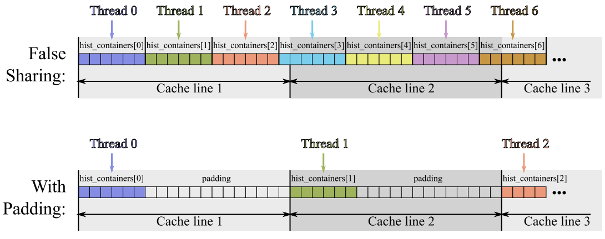

-----

| Title     | Mem CacheLine                                     |
| --------- | ------------------------------------------------- |
| Created @ | `2022-04-27T02:59:04Z`                            |
| Updated @ | `2026-10-16T08:35:14Z`                            |
| Labels    | \`\`                                              |
| Edit @    | [here](https://github.com/junxnone/opt/issues/36) |

-----

# Memory Cacheline

> 本文讨论的现象都是 Cache Line 粒度导致的性能问题，是 [内存优化](0037_Mem) 的具体一个方面。x86 平台主流
> Cache Line 大小是 **64 字节**——CPU 从内存读取数据时，哪怕只要 1 个字节，也会整条 Cache Line（64
> 字节）一起搬进 Cache，这是下面几类问题共同的物理基础。

  - 结构体定义导致的每次 Cache 读取效率低
      - 结构体中包含无用变量
      - 结构体中的数据类型混排对齐
      - 数据行列访问
  - **False Sharing**: 多个线程访问同一 `cache line` 的不同数据

## 基础概念

### 怎么查看本机的 Cache Line 大小

``` bash
# Linux
getconf LEVEL1_DCACHE_LINESIZE          # 直接输出字节数，通常是 64
cat /sys/devices/system/cpu/cpu0/cache/index0/coherency_line_size
lscpu | grep -i cache                    # 顺带看各级 Cache 容量
```

C++17 起标准库还提供了
`std::hardware_destructive_interference_size`（避免伪共享时该隔开多远）和
`std::hardware_constructive_interference_size`（希望放在同一条 Cache Line
时的最大跨度），定义在 `<new>` 头文件里。

### 三类 Cache Miss（3C 模型）

| 类型              | 成因                        | 典型缓解手段                                 |
| --------------- | ------------------------- | -------------------------------------- |
| Compulsory（强制性） | 数据第一次被访问，Cache 里必然没有      | 预取（Prefetch）、提高空间局部性让一次加载带进更多有用数据      |
| Capacity（容量性）   | 工作集总量超过 Cache 容量，旧数据被挤出去  | 循环分块（Blocking/Tiling），把工作集切小到能放进 Cache |
| Conflict（冲突性）   | 容量够，但多个地址映射到同一组（set），互相驱逐 | 调整数据布局/数组维度，避开 2 的幂次步长（见下文 Cache 抖动）   |

### 组相联与 Cache 抖动（Thrashing）

现代 CPU 的 Cache 通常是\*\*组相联（N-way set associative）\*\*结构：内存地址按固定规则映射到某个
set，每个 set 能容纳 N 条 Cache Line。如果程序按某个固定步长访问数组，而这个步长恰好让所有访问都落到同一个 set
上，即使整个 Cache 还很空，这个 set 也会被反复驱逐——这就是 Cache 抖动。

最经典的触发场景是数组行长度正好是 2 的幂次（如 `float a[1024][1024]`，按列访问时步长 4096
字节）。常见规避手段是给数组做**填充（padding）**，把行长度改成非 2 的幂次（如
`a[1024][1024+1]`），打散 set 映射。

## Optimization

### 无用变量

  - 结构体中包含无用变量，导致读取到的有用数据减少，需要更多的读取时间

<!-- end list -->

    struct DATA1
    {
        int a;
        int b;
        int c;
        int d;
    };
    
    struct DATA2
    {
        int a;
        int b;
    };

| Define | 排列                                                           |
| ------ | ------------------------------------------------------------ |
| Data1  |  |
| Data2  |  |

### 数据类型混排对齐

  - 数据类型对齐导致的空间浪费，导致需要读取更多次数

<!-- end list -->

    struct DATA3
    {
        char a;
        int b;
        char c;
    };
    struct DATA4
    {
        int b;
        char a;
        char c;
    };

| Define | 排列                                                           |
| ------ | ------------------------------------------------------------ |
| Data3  |  |
| Data4  |  |

### 数据行列访问

  - 内存以行存储数据, 按行访问数据，每次 Cache 读取能够取到更多有效数据

<!-- end list -->

    // 按列访问
    char * p;
    p = new char[SIZE];
    for (long x=0; x<sRowSize; x++) {
        for (long y=0; y<nbRows; y++) {
            p[x+y*sRowSize]++;
        }
    }

    // 按行访问
    char * p;
    p = new char[SIZE];
    for (long y=0; y<nbRows; y++) {
        for (long x=0; x<sRowSize; x++) {
            p[x+y*sRowSize]++;
        }
    }

| Mode            | 按列访问                                                                                                                       | 按行访问                                                                                                                       |
| --------------- | -------------------------------------------------------------------------------------------------------------------------- | -------------------------------------------------------------------------------------------------------------------------- |
| Cache Line 读取区域 |  |  |

### False Sharing

多个线程各自只读写**不同的变量**，但这些变量恰好被编译器/内存分配器排在了同一条 Cache Line 里，就会出现 False
Sharing（伪共享）：

  - 原理：CPU 之间通过 MESI 等缓存一致性协议维护 Cache Line 的状态。只要一个核心写了这条 Cache Line
    里的任意一个字节，其他核心持有的这条 Cache Line 副本就会被标记失效，必须重新从内存/其他核心的 Cache
    里取数据——哪怕它们实际读写的是这条 Cache Line 里完全不同的字节；
  - 现象：多线程各自更新自己的计数器/局部变量，逻辑上互不相关、本应无锁无冲突，但因为这些变量在内存里挨得太近，实际跑起来却像是在抢同一把锁，多核扩展性不增反降，核数越多问题越明显；
  - 修复思路：把容易被多线程并发写的变量按 Cache Line 大小（64
    字节）对齐、互相隔开（padding），或者让每个线程先各自在私有的局部变量里累加，最后再合并到共享变量里，减少对同一条
    Cache Line 的并发写入次数。



#### 典型案例与修复代码

``` c
// 有问题的写法：counters 数组元素紧挨着，多个线程并发写不同下标，
// 但这些下标都落在同一条 64 字节的 Cache Line 里
long counters[NUM_THREADS];

void worker(int tid) {
    for (long i = 0; i < N; i++) {
        counters[tid]++;      // 看似各写各的，实际在抢同一条 Cache Line
    }
}
```

``` c
// 修复方式一：按 Cache Line 对齐并填充，让每个线程的计数器独占一条 Cache Line
typedef struct {
    long value;
    char padding[64 - sizeof(long)];
} aligned_counter_t __attribute__((aligned(64)));

aligned_counter_t counters[NUM_THREADS];
```

``` c
// 修复方式二（通常更优）：线程内先用私有局部变量累加，结束时再合并一次
void worker(int tid) {
    long local = 0;           // 在寄存器/栈上，完全没有跨核竞争
    for (long i = 0; i < N; i++) {
        local++;
    }
    counters[tid] = local;    // 整个循环只写一次共享内存
}
```

C++ 里可以直接用 `alignas(std::hardware_destructive_interference_size)` 替代硬编码的
64。OpenMP 场景下，`reduction` 子句本身就实现了"线程私有累加 + 最后合并"，一般不需要手动做填充。

#### 怎么确认遇到的真是 False Sharing

False Sharing 不会报错，只表现为"加了线程反而更慢/不加速"，需要用 profiler 确认：

  - **VTune**：用 Memory Access 分析类型，开启 "Analyze Memory Objects"，并把 Memory
    Object Size Threshold 设为 1 以捕获小对象，然后观察是否有多个线程集中访问同一小块内存区域（详见 [Vtune
    Memory Access](0059_Tools_Vtune_AT_MA)）；
  - **perf**：关注 `MEM_LOAD_L3_HIT_RETIRED.XSNP_HITM` 这类事件——HITM（Hit
    Modified）意味着数据是从**另一个核心的 Cache** 里以"已修改"状态取回来的，这正是 Cache Line
    在核间来回弹跳的直接证据；
  - 简单验证法：给可疑的共享变量加上 Cache Line 填充，重新测一遍，如果多核扩展性立刻变好，基本就能确认。

## Reference

  - [CPU Cache
    Optimization](https://zzqcn.github.io/perf/cpu_cache.html)
    \[[code](https://github.com/zzqcn/storage/tree/main/code/c/cache_opt)\]
  - [伪共享（False Sharing）](https://zhuanlan.zhihu.com/p/55917869)
  - [False Sharing - Intel
    Vtune](https://www.intel.com/content/www/us/en/develop/documentation/vtune-cookbook/top/tuning-recipes/false-sharing.html)
