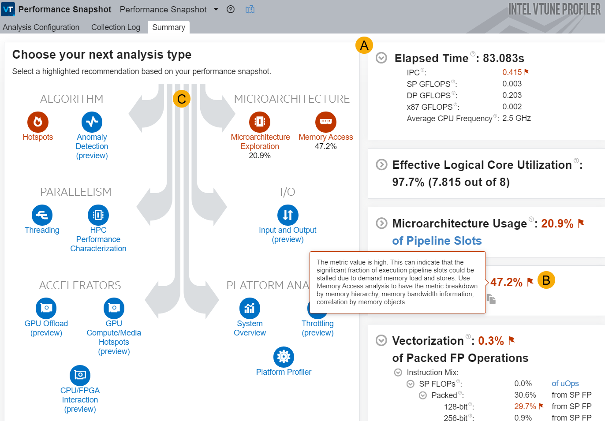

-----

| Title     | Tools Vtune AT PS                                 |
| --------- | ------------------------------------------------- |
| Created @ | `2024-04-20T16:55:17Z`                            |
| Updated @ | `2026-10-14T03:12:48Z`                            |
| Labels    | \`\`                                              |
| Edit @    | [here](https://github.com/junxnone/opt/issues/51) |

-----

# Vtune Performance Snapshot

  - 用于快速评估应用整体性能概况，是不确定问题出在哪时的首选入口（VTune Welcome 页面点击 "Configure
    Analysis" 默认就是这个分析类型）。
  - 采集开销低，几乎不需要额外配置，适合作为深入分析前的"体检"步骤。
  - 结果会把高层 Metrics 中超出正常范围的项标红，并在 Analysis Tree 里推荐下一步该跑哪个具体的 [Analysis
    Type](/0062_Tools_Vtune_AT)。
  - 优化后建议重新跑一遍 Performance Snapshot，校准结果、确认是否出现新的瓶颈。



>   - **A**: 高层 Metrics 面板，常见包括：
>       - **Elapsed Time**: 应用总运行时间（不含采集暂停的时间）
>       - **CPU Utilization**: 逻辑核的平均利用率，100%
>         代表所有逻辑核全程繁忙（不区分是否为有效工作，并行运行时开销也会计入）
>       - **Memory Bound / Memory Stalls**: 流水线因访存指令停顿的比例，偏高时需要结合
>         [Memory Access](/0059_Tools_Vtune_AT_MA) 进一步定位是 Cache 还是 DRAM
>         带宽问题
>       - **Vectorization**: 向量化指令的使用占比
>       - **GPU Utilization**: 如果应用有 GPU 卸载，这里会显示 GPU 侧利用率
>   - **B**: 红色的部分代表该项超出正常范围、存在性能瓶颈或可优化空间，鼠标悬停可看具体数值和改进建议
>   - **C**: Analysis Tree 中标红的分析类型，是针对当前检测到的问题推荐的下一步分析（例如 Memory Bound
>     高会指向 Memory Access，CPU Utilization 低且是多线程应用会指向 Threading）

## 命令行

``` bash
vtune -collect performance-snapshot -result-dir r000ps ./app
```

## Reference

  - [Performance
    Snapshot](https://www.intel.com/content/www/us/en/docs/vtune-profiler/user-guide/2025-0/performance-snapshot.html)
  - [Interpret Performance Snapshot Result
    Data](https://www.intel.com/content/www/us/en/docs/vtune-profiler/tutorial-common-bottlenecks-linux/2024-1/interpret-performance-snapshot-result-data.html)
