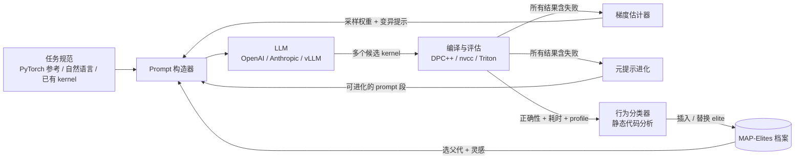
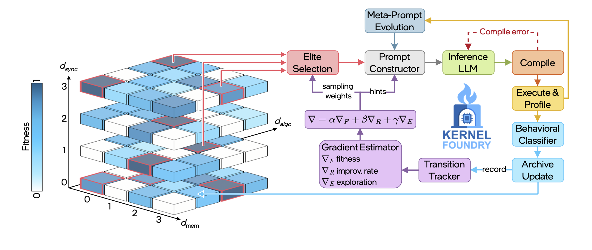

-----

| Title     | papers KernelFoundry                              |
| --------- | ------------------------------------------------- |
| Created @ | `2026-11-25T15:55:54Z`                            |
| Updated @ | `2026-11-25T15:55:54Z`                            |
| Labels    | \`\`                                              |
| Edit @    | [here](https://github.com/junxnone/opt/issues/76) |

-----

# KernelFoundry

KernelFoundry: Hardware-Aware Evolutionary GPU Kernel
Optimization（Intel，ICML 2026，arXiv:2603.12440）。一个用 LLM 做 GPU kernel
优化的**进化框架**：用 MAP-Elites
质量-多样性（Quality-Diversity）档案保持不同优化路线并存，用梯度式的"转移统计"引导变异方向，用元提示（meta-prompt）与
kernel 共同进化，用模板化 kernel 自动调 tile/block 等参数，并配有分布式执行框架。主推 SYCL（Intel
GPU），同时支持 CUDA / Triton / OpenCL。

  - 论文：<https://arxiv.org/abs/2603.12440>
  - 项目页：<https://isl-org.github.io/kernelfoundry/>
  - 代码：<https://github.com/isl-org/kernelfoundry>（Apache-2.0）
  - 作者：Nina Wiedemann\*, Quentin Leboutet\*, Michael Paulitsch, Diana
    Wofk, Benjamin Ummenhofer（Intel，\* 共同一作）

标注约定：**\[解读\]** 为笔者理解，**\[待核实\]** 为 PDF 抽取后表格/公式对不齐、未能与原文逐项核对的内容。

## 1\. 解决什么问题

写高性能 GPU kernel 需要同时懂硬件架构、内存层次和并行范式，这类人才稀缺。KernelBench 之后，大量工作让 LLM 走"生成
→ 编译 → 校验 → 计时 → 反馈"的循环，但论文指出这种通用代码生成式的循环有两个典型问题：

  - **mode collapse（模式坍缩）**：迭代修改相当于贪心局部搜索，LLM 总是在最近成功的版本附近改，过早收敛；
  - **context degradation（上下文退化）**：历史越长，失败尝试越多地占满 prompt，生成质量下降。

另外，多数工作只面向 NVIDIA/CUDA。KernelFoundry 的对应设计：

| 问题                      | 对应设计                                  |
| ----------------------- | ------------------------------------- |
| 模式坍缩                    | MAP-Elites 档案 + kernel 专用行为描述符（3.2 节） |
| 单个 cell 内停滞             | 梯度式转移统计，生成变异提示（3.3 节）                 |
| tile / block 等参数靠 LLM 猜 | 模板化 kernel，由流水线枚举实例化（3.4 节）           |
| 上下文退化                   | 元提示进化（3.5 节）                          |
| 规模与异构硬件                 | 分布式执行框架（3.6 节）                        |
| 仅 CUDA                  | SYCL 为主，兼容 CUDA / Triton              |

表中：左列是论文识别出的问题，右列是针对它的设计，括号内为本文对应小节。

### 1.1 相关工作定位（论文第 2 节）

| 路线        | 代表工作（论文所引）                                                          | 特点 / 与 KernelFoundry 的差别                              |
| --------- | ------------------------------------------------------------------- | ----------------------------------------------------- |
| 基准        | KernelBench（250 个任务：单算子、融合、完整架构）                                    | 事实标准；前沿模型在其上正确率仅约 20%，且存在高达 50× 的虚假加速（错误 kernel 通过测试） |
| 提示 + 验证循环 | CUDA / Triton / Metal 的多项工作；PEAK（用自然语言描述优化变换，MatMul 达 cuBLAS 的 95%） | 靠正确性与 profile 输出逐步修改                                  |
| 多 agent   | Astra（规划/编码/测试/profile）、STARK、QiMeng、PRAGMA                         | 把任务拆成不同角色                                             |
| 硬件知识注入    | SwizzlePerf（bank conflict、warp 操作、合并访问等微架构知识写入 prompt）              | 证明硬件感知有价值                                             |
| 进化        | AI CUDA Engineer、OpenEvolve（AlphaEvolve 开源实现）等                      | 无 kernel 专用的多样性机制                                     |
| 微调        | 多轮 RL、对比 RL 等                                                       | 论文自己不采用，列为未来方向                                        |

表中：左列是路线，中列是论文引用的代表，右列是特点。论文的判断是：这些方法"隐式地"通过通用代码生成探索 kernel
设计空间，缺少保持不同优化轨迹多样性的机制；KernelFoundry
用显式的行为描述符补上这点。上表条目取自论文第 2 节的概述，完整对比见论文表 5。

## 2\. 整体流程

论文把系统分为五个紧耦合组件：任务规范层、prompt 构造引擎、LLM 推理后端、编译与评估流水线、进化档案。



图中：

  - **任务规范**：输入可以是 PyTorch 参考实现、自然语言描述或需要优化的已有 kernel；原生支持
    KernelBench，也支持用户自定义的 pytest 测试；
  - **Prompt 构造器**：把任务、硬件优化指引、从档案采样的父代与"灵感"、梯度提示、被进化的 prompt 段拼成一个
    prompt；
  - **LLM**：统一接口，既可调 API 模型，也可用本地 vLLM，每轮生成多个候选；
  - **编译与评估**：编译（SYCL 用 Intel DPC++，CUDA 用 nvcc，或
    Triton）、对参考实现做数值校验、计时，可选用 Intel
    unitrace / NVIDIA Nsight 采集 profile；
  - **行为分类器**：对通过正确性的 kernel 做静态模式匹配，给出行为坐标，再决定能否进入档案；
  - **反馈箭头**：失败案例也会回流给梯度估计器和元提示器，这是和"只保留成功"的方案的不同点。

每轮迭代：从档案按策略选父代 → 构造 prompt → LLM 生成候选 → 编译/校验/计时 → 分配行为坐标 → 优于现有 elite
才写入档案。

### 2.1 Prompt 的组成（附录 E.1）

主 prompt 由下列部分拼成（尖括号为占位符）：

| 部分         | 内容                                                                                        |
| ---------- | ----------------------------------------------------------------------------------------- |
| 角色与目标      | "GPU kernel 优化专家"，给定参考实现，产出功能相同且更快的 kernel；代码会被粘贴进现有工程，需沿用既有结构与函数签名                       |
| 加载方式       | 代码存入 `kernel.cpp` / `kernel.cu`，通过 `torch.utils.cpp_extension.load()` 加载，调用 `.forward` 测试 |
| 示例         | 一份"参考实现 → 正确 kernel"的示例                                                                   |
| 参考代码 / 任务  | 待优化的参考实现                                                                                  |
| 最优 kernel  | 目前测得最好的 kernel 及其运行时间                                                                     |
| 上一个 kernel | 上次测试的 kernel、运行时间与控制台输出（含编译/运行报错）                                                         |
| 硬件规格       | 目标硬件参数，提示"优化时考虑硬件规格"                                                                      |
| 优化策略       | **可进化段**（见第 6 节）                                                                          |
| 关键要求       | 功能必须与参考完全一致；必须能编译运行；**不得缓存或复用之前的结果**（防作弊）                                                 |
| 输出格式       | 先"分析"上一个 kernel 的问题和改动思路，再给出完整代码块                                                         |

表中：左列是 prompt 的段落，右列是内容摘要。"关键要求"里禁止缓存复用结果，是针对 reward hacking 的约束之一。

### 2.2 Profiler 反馈（附录 B.3）

对正确的 kernel 可选地采集 profile，并整理成自然语言摘要喂回 prompt：执行时间、内存带宽（实测 vs 理论峰值，经
unitrace 或 Nsight Compute）、计算利用率（ALU 占用、指令吞吐）、瓶颈判断（memory-bound /
compute-bound）。论文给的例子："Kernel is memory-bound at 45% of peak bandwidth.
Consider shared memory tiling to improve data reuse."

## 3\. 质量-多样性搜索（MAP-Elites）

### 3.1 算法

MAP-Elites 把解空间按"行为描述符"划成离散网格，每个格子（cell）只保留该区域内适应度最高的解（elite）。论文把它拆为四步：

1.  **选择**：从已占用的 cell 中采样父代；
2.  **变异**：LLM 根据父代、优化提示和元进化内容改写代码；
3.  **评估**：编译、校验、计时，并静态分析出行为坐标；
4.  **插入**：若目标 cell 为空或子代优于现有 elite 则替换，否则丢弃。

由于每个 cell 独立演化，档案在构造上就不会坍缩到一种写法。

### 3.2 kernel 专用的行为描述符

不同于以往用"代码长度"之类的通用描述符，KernelFoundry 定义了三维、每维 4 级、共 $4^3 = 64$ 个 cell
的特征空间，坐标由生成代码的静态模式匹配（SYCL / CUDA 语法结构）确定，保证可复现、没有运行时抖动。

| 维度     | 符号          | 0            | 1                   | 2                           | 3                      |
| ------ | ----------- | ------------ | ------------------- | --------------------------- | ---------------------- |
| 内存访问模式 | $d\_{mem}$  | 标量、跨步或非合并访问  | 合并 / 向量化（vec4、对齐加载） | 共享/本地内存 + 显式 tiling         | 多级层次（SLM + 寄存器分块 + 预取） |
| 算法结构   | $d\_{algo}$ | 直接翻译 PyTorch | 融合算子（单次遍历数据）        | 重构算法（在线归一化、flash 模式）        | 新颖 / 渐近更优的算法           |
| 并行协调   | $d\_{sync}$ | 无同步（完全并行）    | work-group barrier  | sub-group 原语（shuffle、归约、广播） | 全局协调（原子操作、带同步的多趟）      |

表中：每一行是一个行为维度，0–3 列是该维度的级别，级别越高代表越"复杂"的优化手段；分类器用带权重的模式匹配，并避免重复计分（例如为 SLM
同步而用的 group barrier，只计入 $d\_{mem}$ 的 SLM 使用，不再计入 $d\_{sync}$）。

### 3.3 适应度函数

$$ f(k) = \\begin{cases} 0 & \\text{编译失败} \\ 0.1 & \\text{编译通过但结果不正确} \\
0.5 + 0.5 \\cdot s\_{norm} & \\text{结果正确} \\end{cases} \\qquad s\_{norm}
= \\min\\left(1, \\frac{\\text{speedup}}{\\text{target}}\\right) $$

其中：

  - $f(k)$：kernel $k$ 的适应度，取值 $\[0,1\]$；
  - $s\_{norm}$：归一化加速比；speedup 为相对基线（默认 PyTorch eager）的加速倍数；
  - target：可配置的目标加速比，默认 2×；
  - 含义：正确性是高适应度的前提（正确即 $\\ge 0.5$），之后用连续的性能项继续提供梯度；达到 target 后适应度封顶。

### 3.4 父代选择策略

可配置混合比例的四种：均匀采样（最大化行为多样性）、适应度比例采样（利用高性能区域）、好奇心驱动（偏向梯度信号显示改进潜力高的
cell）、岛屿式（$K$ 个子种群，每 $M$ 代迁移一次）。

## 4\. 梯度式进化引导

仅靠档案能防止全局坍缩，但单个 cell 仍可能反复得到相似变体。论文借鉴
CMA-ME、PGA-MAP-Elites，用"进化转移历史"构造类梯度信号：用循环缓冲区记录最近的父→子转移，每条记录保存父/子行为坐标
$(b\_p, b\_c)$、适应度差 $\\Delta f = f\_c - f\_p$、结果类型（改进 / 中性 /
退化）以及用于时间加权的时间戳。对每个已占用 cell 计算三个分量：

$$ \\nabla^F\_d b = \\frac{1}{|T|}\\sum\_{t\\in T} \\Delta f\_t \\cdot
\\mathrm{sign}\\big(b\_c^{(d)} - b\_p^{(d)}\\big)\\cdot w(t) $$

$$ \\nabla^R\_d b \\approx P(\\text{imp} \\mid \\Delta b\_d \> 0) -
P(\\text{imp} \\mid \\Delta b\_d \< 0) $$

$$ \\nabla^E b \\propto \\sum\_{c\\in E} (f\_{max} - f\_c)\\cdot
\\frac{c - b}{\\lVert c - b\\rVert\_1} \\quad \\text{\[待核实：PDF 抽取的公式 (3)
归一化项不完整，此处为按文字描述的还原\]} $$

$$ \\nabla b = \\alpha \\nabla^F b + \\beta \\nabla^R b + \\gamma
\\nabla^E b,\\qquad (\\alpha,\\beta,\\gamma) = (0.4, 0.4, 0.2) $$

其中：

  - $T$：从 cell $b$ 出发的转移集合；$d$：行为维度（mem / algo / sync）；
  - $w(t)$：对时间指数衰减的权重，让近期经验权重更大；
  - $\\nabla^F$（适应度梯度）：哪个方向的行为变化更能提高适应度；
  - $\\nabla^R$（改进率梯度）：沿某维度增大 vs 减小时"产生改进"的概率之差，只看概率、不看改进幅度；
  - $\\nabla^E$（探索梯度）：指向空 cell 或低质量 cell，按距离的倒数和改进潜力加权；$E$ 为这些 cell
    的集合，$f\_{max}$ 为最大适应度，$f\_c$ 为 cell $c$ 的适应度；
  - $\\alpha,\\beta,\\gamma$：三个分量的权重，论文取 0.4 / 0.4 / 0.2。

**梯度如何用**：一是调整父代采样概率（梯度强的 cell 被更多采样）；二是翻译成自然语言变异提示注入 prompt，例如
$d\_{mem}$ 方向梯度为正时，提示"考虑加共享内存 tiling""用寄存器分块复用数据"。**\[解读\]**
它不是对代码求导，而是用"哪类改动历史上更容易成功"的统计量做软引导。

**论文给出的例子（附录 E.3）**：某父代 kernel 运行 0.021
ms；框架发现内存维度（$d\_{mem}$）上的适应度梯度为正，向下一轮
prompt 注入提示："Use register tiling: each thread computes an M×N output
block in registers. Apply `#pragma unroll` … Combine with shared memory
tiling for multi-level memory hierarchy optimization."子代据此把扁平累加数组改为显式
2×2 寄存器分块，重构内层循环同时累加 4 个相邻卷积输出，并在所有内层循环加 `#pragma unroll`，运行时间降到 0.0195
ms，约 **7%** 提升。注意这只是单个示例，不是统计结论。

## 5\. 模板化 kernel：参数调优

work-group 大小、tile 大小、展开因子这类硬件相关参数，让 LLM "猜"通常不优。做法：prompt 允许 LLM
额外输出一个带可配置参数的模板化 kernel，加一个枚举合法参数组合的 dispatch
函数；评估流水线检测到模板后提取参数配置，**逐个实例化并独立评测**，最佳配置的成绩作为该
kernel 的适应度，所有结果记入日志供后续迭代参考。这样算法层面的优化与参数调优被分开，进化搜索可同时探索两个维度。

实验里的 "+ parameter optim." 指在 40 轮进化之后再额外跑 2 轮参数优化。

**模板化 kernel 的约定（附录 E.2）**：参数优化阶段使用单独的 prompt，把当前最优 kernel 交给
LLM，要求改写成"模板 kernel + 分发函数"的 PyTorch 扩展。论文给的 SYCL
示例（逐元素乘）结构如下：

``` cpp
// 1. kernel 名称结构体（namespace 作用域，随模板参数区分实例）
template <int BX, int BY> struct ElementwiseMulKernel {};

// 2. 模板化的 host 函数：BLOCK_X / BLOCK_Y 为可调参数，据此计算 global/local range
template <int BLOCK_X, int BLOCK_Y>
void elementwise_mul_sycl_kernel(torch::Tensor A, torch::Tensor B, torch::Tensor C, int N, int M);

// 3. 分发函数：参数名与模板参数对应，枚举合法组合
torch::Tensor forward(torch::Tensor A, torch::Tensor B, int block_x, int block_y) {
  if (block_x == 16 && block_y == 16) return forward_templated<16, 16>(A, B);
  else if (block_x == 32 && block_y == 8) return forward_templated<32, 8>(A, B);
  else if (block_x == 8 && block_y == 32) return forward_templated<8, 32>(A, B);
  else TORCH_CHECK(false, "Unsupported block size combination");
}

// 4. Pybind11 接口暴露 forward
PYBIND11_MODULE(TORCH_EXTENSION_NAME, m) { m.def("forward", &forward, "..."); }
```

说明：以上是对论文 Listing 1 的节选改写（省略了 `data_ptr`、`q.submit` 等函数体细节）。要求总结为：kernel
对合适参数（如 block size）模板化；`forward_templated` 负责按给定参数启动；`forward`
参数与模板参数对应并选择正确实例化；功能与原 kernel 一致；包含 Pybind11
接口。流水线通过 `forward` 的 dispatch 选项枚举各配置并分别评测。

## 6\. 元提示进化

随着搜索推进，失败历史会挤占上下文（论文引用的术语为 context pollution）。受 CodeEvolve、GEPA
启发，KernelFoundry 让 prompt 本身可变并与 kernel 共同进化：

  - **四个可进化段**：(1) 优化哲学（如"先榨干内存带宽再优化计算"）；(2) 优化策略（按内存/计算/并行分类的具体技术 +
    典型代码模式）；(3) 常见陷阱（如共享内存加 padding 避免 bank conflict）；(4)
    分析指引（编码前先识别瓶颈的推理脚手架）；
  - **Meta-Prompter LLM**：独立于 kernel 生成器的另一个 LLM，输入当前可进化段、生成的 kernel
    与评估指标（正确性、加速比、报错），先诊断"缺了/误导了什么指引"，再以 SEARCH/REPLACE diff
    的形式只修改可进化区域；
  - **Prompt 档案与共进化**：prompt 变体有自己的档案，适应度为用该 prompt 取得的最佳 kernel 性能；每
    $N$ 代（默认 $N=10$）元提示器提出一次更新。

**\[解读\]** 两个 LLM 的分工把"分析"与"生成"分开，prompt 的演化结果是任务特定的优化策略。

**Prompt 实际如何演化（附录 J，定性分析）**：作者用 difflib 的 SequenceMatcher 计算不同训练步
prompt 的两两相似度。有的问题 prompt 变化很大，有的则聚成簇、长期相似；早期与很晚期的 prompt
之间还会出现相似（说明趋向稳定结构）。人工检查发现"优化策略"和"常见陷阱"两段修改最频繁，"优化哲学"和"分析指引"相对稳定。新增内容的例子：

  - 反模式及修复："Reinterpreting host pointers to vector types inside kernels
    is unsafe unless the pointer is device-USM and properly
    aligned"（并附生成代码中出现的 `reinterpret_cast<sycl::float4*>`
    反模式）；
  - 情境化建议："Use direct convolution with shared memory when kernel sizes
    are small (3×3, 5×5) and memory reuse within a tile is high"。

**\[解读\]** 这类内容更像"从失败里学出来的 SYCL 编码规约"，也是元提示相比固定 prompt 的价值所在。

## 7\. 分布式执行框架


图中：框架分四类 worker——LLM 服务器（云 REST API 或本地 vLLM）、编译 worker（跑 DPC++ /
nvcc，**不需要 GPU**）、执行 worker（在 GPU 节点跑正确性与性能测试，通过任务队列连接）、数据库服务器。只有执行
worker 需要 GPU，通过路由到不同 worker 即可切换 Intel / NVIDIA 后端；同构 worker
可并行加速评测。（图片来自项目页。）

补充（附录 C）：主线程是轻量的，与四类服务器交互，服务器可在同一台机器，也可分布在同一网络的多台机器上；LLM 服务器、编译
worker、执行 worker 通过负载均衡器和队列相连，可按需扩展 worker 数量；执行 worker
通过任务队列保证**每块 GPU 同一时刻只跑一个任务**（隔离，避免互相干扰计时）；数据库保存全部生成的
kernel、评估结果和进化状态，以便复现与分析，也为 RAG 和后续检索提供来源。

**自定义任务格式**：任务由一组带特殊标记的文件定义，便于集成进现有项目：

| 文件                               | 作用                                                                                                  |
| -------------------------------- | --------------------------------------------------------------------------------------------------- |
| `config.yaml`                    | 超参数与目标，例如 `language: SYCL`、`gpu_arch: bmg`                                                          |
| `Test.py`（Python 模块）             | 含 build 函数，以及用 pytest 写的正确性测试和性能测试（也就是"参考代码 + 测试 + 性能度量"）                                           |
| 语言相关的 kernel 文件（如 `kernel.sycl`） | 生成代码所在文件；用 `EVOLVE START` / `EVOLVE END` 标记**允许被进化的区段**，其余模型代码保持不变；另可用标记给出参考代码、可选的用户指令和可选的初始 kernel |

表中：每行是任务包里的一个文件。这使得优化对象不再局限于"PyTorch 参考实现"，可以是工程里的任意一段 kernel；README 里的
MCP 流程里，agent 也是按这个任务包格式去构造测试并调用工具。



图中：项目页给出的算法示意图，对应第 2 节的主循环：档案采样 → prompt 构造 → LLM 生成 → 编译/执行/profile →
行为分类 → 档案更新，并有梯度估计器与元提示进化两条反馈。（图片来自项目页。）

## 8\. 实验设置

  - **硬件**：集成显卡 Intel Arc 140V（LNL）、独立显卡 Intel Battlemage B580（BMG），以及
    NVIDIA RTX A6000（CUDA 对比用）；
  - **语言**：SYCL 为主（开放标准、C++ 抽象更适合 LLM 生成、单一代码库跨平台），CUDA 用于和已有工作比较；
  - **基准**：KernelBench（250 个任务，L1 单算子 / L2 融合 / L3 完整架构）；按 Lange et al.
    2025b 与 METR 的做法过滤掉易 reward hacking 或基线低效的任务，得到 **111 个**（80 个 L1 +
    31 个 L2）；多数实验用代表性子集 **40 个**（20 L1 + 20 L2）；另用 robust-kbench 的
    **12** 个任务（共 19 个含前向/反向的任务，但对方只公开了 12 个的最优 kernel）；
  - **基线**：PyTorch eager、`torch.compile`，以及公开了 kernel 的 robust-kbench、AI
    CUDA Engineer、Kernelsseum；由于模型下线，只能使用对方 LLM 的子集（对 robust-kbench 用
    GPT-{o3, o4-mini, 4.1}，对 AI CUDA Engineer 仅用 o3-mini）；
  - **指标**：正确率、$\\mathrm{fast}\_p$（加速比大于 $p$ 的任务占比）、平均/几何平均加速比；
  - **更严格的正确性判定**：KernelBench 的绝对精度 $10^{-2}$ 过松，小输出值下错误 kernel
    也能通过。论文改用相对误差，在 99% 的输出元素上相对误差 $\<0.01$
    才算正确，并加了展平输出张量的余弦相似度作为第二指标；
  - **SYCL 实验配置**：第 1 轮用强模型（Claude Sonnet 4.5）避免一开始陷入局部最优，之后用 GPT-5 mini
    与 GPT-4.1 等权集成；40 轮后再做 2 轮参数优化。

### 8.1 计时方法的改进（附录 B.2）

论文指出对既有工作的计时做了几处降方差的改动：

  - 先跑固定次数的初始试验估算 kernel 大致耗时，再据此决定 warmup
    与正式测量次数——**按最小总时间而非固定次数**设定（kernel
    慢则次数少）；
  - 对非常快的 kernel，`torch.cuda.synchronize` / `torch.xpu.synchronize`
    本身开销显著，于是在每次 synchronize 前用**内层循环**连续执行多次；
  - 取值：最小 warmup 时间 1 s、最小 warmup 迭代 10 次、内层循环最小时间 0.01 s、最少正式迭代 10
    次、正式测量最小时长 1 s；
  - robust-kbench 里 backward 算子的计时含有 `torch.autograd` 的开销。作者找到了单独测量
    kernel 执行时间的办法（更稳定），但参考实现仍需用 `torch.autograd.grad` 测量，因此 backward
    的加速比会很高（见表 7），作者认为这相比"错误的 kernel 计时"只是小缺点。

### 8.2 KernelBench 任务过滤与代表集（附录 D）

  - Lange et al. 2025b 提出 5 条过滤准则：(1) 输出值范围小；(2) 输出标准差小；(3)
    沿任一轴的输出标准差小；(4) 输入对输出影响小；(5)
    基线低效。本文采用与其相同的任务集以保证一致；
  - 作者的看法：准则 (3) 过严（例如某轴长度为 2 时标准差天然较低，生成的 kernel 并无问题），准则 (5)
    也不一定要剔除（比较仍然公平；且 Lange 用 LLM 识别这类任务，复查时有判断错误）。只用
    (1)(2)(4) 过滤可保留 **223** 个任务（L1+L2+L3）；
  - 代表集（20 L1 + 20 L2）的选取标准：覆盖各类算子（matmul、conv、转置卷积、激活函数等）；不含被 Lange
    判为"受污染"的任务；且对方公开了 kernel，并且其每任务最快 kernel 能通过本文更严格的测试——229 个
    kernel 中有 **53** 个未通过本文测试。

### 8.3 默认超参数（表 6）

| 类别  | 参数                               | 值                                       |
| --- | -------------------------------- | --------------------------------------- |
| 进化  | 最大代数 / 每代种群                      | 40 / 8（随实验调整）                           |
|     | 选择策略                             | curiosity-driven                        |
|     | 档案维度 / 每维 bin 数                  | 4 / 4（PDF 抽取得到，与正文"3 维"不一致，**\[待核实\]**） |
| 评估  | warmup / 计时迭代                    | 10 / 100                                |
|     | 目标加速比                            | 2.0×                                    |
| 元提示 | 更新频率 / 每次最大变异数 / prompt 档案大小     | 每 10 代 / 3 / 16                         |
| LLM | temperature / max tokens / top-p | 0.3 / 8000 / 1                          |

表中：对 AI CUDA Engineer 的对比用 40 代、种群 4；对 robust-kbench 用 40 × 8（对方每轮采样 8
个建议）；SYCL 实验沿用 40 × 8。

$$ \\mathrm{fast}*p =
\\frac{1}{N}\\sum*{i=1}^{N}\\mathbb{1}\\left\[\\mathrm{speedup}\_i \>
p\\right\] $$

其中：

  - $N$：任务总数；$\\mathbb{1}\[\\cdot\]$：条件成立为 1，否则为 0；
  - $\\mathrm{speedup}\_i$：任务 $i$ 的基线耗时 / kernel 耗时（默认基线为 PyTorch
    eager）；
  - $\\mathrm{fast}\_1$ 表示"比基线快的任务占比"，$\\mathrm{fast}\_2$ 表示"快 2
    倍以上的占比"。

## 9\. 结果

### 9.1 CUDA 基线对比（表 1，节选平均加速比）

| 任务集                      | 方法                         | 平均加速比  | 几何平均加速比 |
| ------------------------ | -------------------------- | ------ | ------- |
| KernelBench 代表集 L1（n=20） | Kernelsseum（L40S）          | 0.765  | 0.600   |
|                          | AI CUDA Engineer 原报告（H100） | 1.422  | 1.222   |
|                          | AI CUDA Engineer 重新评测      | 1.005  | 0.909   |
|                          | KernelFoundry              | 1.204  | 1.092   |
|                          | KernelFoundry + 参数优化       | 1.241  | 1.124   |
| KernelBench 代表集 L2（n=20） | Kernelsseum（L40S）          | 0.874  | 0.854   |
|                          | AI CUDA Engineer 原报告（H100） | 1.589  | 1.524   |
|                          | AI CUDA Engineer 重新评测      | 1.606  | 1.515   |
|                          | KernelFoundry              | 2.051  | 1.680   |
|                          | KernelFoundry + 参数优化       | 2.104  | 1.730   |
| robust-kbench（n=12）      | robust-kbench 原报告（H100）    | 15.622 | 2.591   |
|                          | robust-kbench 重新评测         | 8.865  | 3.499   |
|                          | KernelFoundry              | 12.107 | 5.295   |
|                          | KernelFoundry + 参数优化       | 12.081 | 5.225   |

表中：每行一种方法在对应任务集上的结果；"重新评测"指在作者自己的 NVIDIA A6000 上复现对方公开的
kernel（原报告硬件不同，PyTorch 耗时不同，不能直接比）；Kernelsseum 在
L40S、两个"原报告"在 H100、其余在 A6000。正确率与 $\\mathrm{fast}\_p$ 两列因 PDF
抽取后列顺序对不齐，本文未转录 **\[待核实，见论文表 1\]**。

论文给出的结论：L1 平均加速 1.24、L2 为 2.1，对应 AI CUDA Engineer 的 1.01 和 1.61；在
robust-kbench 的 12 个含反向的任务上，比对方最佳 kernel 的加速比高 **36%**（12.107 /
8.865）。robust-kbench 的平均值明显偏高（12.107，而几何平均只有 5.295），原因之一是 backward
算子的参考实现用 `torch.autograd.grad` 计时、含额外开销，见 8.1
节。多数任务靠进化选择本身就能找到合适的参数，参数优化（仅
2 轮，best@8）在个别任务上带来明显提升。每个 kernel 平均成本约 **$5.7**。

**成本估算（附录 I）**：在 5 个 KernelBench L2 问题上按表 1 同配置（40 轮 × 4 分支 = 160
个候选，o3-mini）测 token，平均每个 kernel 输入 11,102、输出 5,377 token；按
o3-mini 定价（$1.10 / 百万输入、$4.40 / 百万输出）约 $5.74 / kernel；换成较新的模型（gpt-5.4）则约
$17.34 / kernel。对比：robust-kbench 报告约 $5 / kernel，METR 在 o3-mini 上展示最高约
$20 / kernel 的收敛。作者的观点是，如果能显著减少人工工程量，较高成本是合理的。

### 9.2 SYCL kernel 生成（表 2）

| 配置                        | 任务集                   | 正确率  | fast₁ | fast₂ | 平均加速比 | 几何平均  |
| ------------------------- | --------------------- | ---- | ----- | ----- | ----- | ----- |
| KernelFoundry（SYCL）       | KernelBench 过滤集 n=111 | 0.97 | 71%   | 42%   | 2.32  | 1.38  |
| robust-kbench（CUDA，对方报告）  | 同上                    | \-   | \-    | \-    | 1.49  | \-    |
| OpenEvolve，40 轮           | 代表集 L2 n=20           | 1.0  | 70%   | 40%   | 2.535 | 1.775 |
| KernelFoundry，40 轮 + 参数优化 | 同上                    | 1.0  | 80%   | 45%   | 2.732 | 2.119 |
| OpenEvolve，10 轮           | 同上                    | 1.0  | 70%   | 20%   | 1.483 | 1.202 |
| KernelFoundry，10 轮        | 同上                    | 1.0  | 80%   | 35%   | 2.059 | 1.661 |
| KernelFoundry，20 轮        | 同上                    | 1.0  | 70%   | 50%   | 2.539 | 1.833 |
| 20 轮，去掉 prompt 进化         | 同上                    | 1.0  | 70%   | 55%   | 2.505 | 1.600 |
| 20 轮，去掉梯度引导               | 同上                    | 1.0  | 75%   | 35%   | 2.178 | 1.695 |

表中：前两行是 111 个过滤任务的总体结果（SYCL 对比 robust-kbench 在 CUDA 上的报告值）；后七行都在代表集 L2 的
20 个任务上，用于对比 OpenEvolve（AlphaEvolve 的开源实现，使用进化但没有 kernel
专用策略、元提示与参数优化）和做消融。LLM 为 GPT-{4.1,
5-mini} 与 Sonnet-4.5。

要点：

  - 虽然 SYCL 对 LLM 不如 CUDA 熟悉，仍在 97% 的任务上得到正确 kernel，平均加速 2.32；
  - OpenEvolve 跑满 40 轮后与 KernelFoundry 的平均加速接近（2.535 vs 2.732），但 10
    轮时差距明显（1.483 vs 2.059），即**收敛更快**；
  - 消融（20 轮）：去掉 prompt 进化或梯度引导，几何平均加速都低于完整方法（1.600 / 1.695 vs
    1.833）；平均加速比只有小幅下降，且去掉 prompt 进化时 fast₂ 反而更高（55% vs
    50%），所以各组件的贡献在 20 个任务的样本上并不单调 **\[解读\]**。

**补充：prompt 进化频率与逐任务差异（附录 F.4，代表集 L2 的 20 个任务）**

| 配置                | 平均加速比 | 几何平均  |
| ----------------- | ----- | ----- |
| 无 prompt 进化       | 2.505 | 1.600 |
| prompt 进化（每 10 代） | 2.539 | 1.833 |
| prompt 进化（每 2 代）  | 2.542 | 1.944 |

表中：三行分别为不进化、每 10 代、每 2 代进化一次 prompt（均为 20 轮）。几何平均随进化更频繁而上升（1.600 → 1.833
→ 1.944），平均加速比几乎不变。逐任务看差别很大：例如 `32_Conv2d_Scaling_Min` 三种配置分别为 9.541 /
9.196 / 6.446，`35_Conv2d_Subtract_HardSwish_MaxPool_Mish` 为 2.759 /
6.831 / 8.717，而 `47_Conv3d_Mish_Tanh` 为 1.368 / 0.649 /
0.525（此任务反而变慢）。**\[解读\]** 单个任务上方差很大，进化 prompt
并不总是更好，汇总数字的差异应结合任务数（20）和随机性理解。

**收敛曲线（附录 H）**：逐迭代的"当次最佳"曲线显示有些迭代偏探索、加速比较低，说明系统在更广区域搜索；扩展到 100 轮时，即使在 80
轮之后仍能找到更快的 kernel，使用元提示时尤其明显（论文图 6 给了两个例子）。

**开源模型（附录 G）**：用 GPT-OSS 20B 在同样的 20 个 L2 任务上生成 SYCL kernel，即使跑 40 轮、种群
4，仍有 **7/20** 个任务没能生成正确 kernel；成功的任务里有优化，例如第 16
个任务（`16_ConvTranspose2d_Mish_Add_Hardtanh_Scaling`）在 LNL 上加速
1.775。说明框架对模型能力仍有依赖。

### 9.3 硬件感知验证（表 3）

交叉实验：在 B580 与集成显卡 Arc 140V（LNL）上分别跑 KernelFoundry，再把各自的最优 kernel 放到对方
GPU 上测速。若方法真的做到硬件感知，应出现"在 A 上优化的 kernel 在 A 上比在 B 上优化的 kernel
更快"。定义硬件感知加速比

$$ \\mathrm{hws}(k\_A) = \\frac{t\_A(k\_B)}{t\_A(k\_A)} $$

其中：

  - $k\_A$、$k\_B$：分别在 GPU A、GPU B 上优化出的最优 kernel；
  - $t\_A(\\cdot)$：该 kernel 在 GPU A 上的运行时间；
  - $\\mathrm{hws}\>1$：为 A 专门优化的 kernel 在 A 上更快；$\\mathrm{hws}\_p$ 为
    $\\mathrm{hws}\>p$ 的 kernel 占比。

| kernel              | hws₁ | hws₁.₅ | 平均 hws | 几何平均 hws |
| ------------------- | ---- | ------ | ------ | -------- |
| LNL 优化的 $k\_{LNL}$  | 70%  | 20%    | 1.537  | 1.297    |
| BMG 优化的 $k\_{B580}$ | 70%  | 15%    | 1.109  | 1.038    |

表中：任务为代表集 L2 的 20 个；两行分别是为 LNL / BMG 优化的 kernel 相对另一块 GPU
上优化的版本的优势。结论：70% 的 kernel 在目标 GPU 上比"另一块 GPU
上优化的版本"更快。**\[解读\]** 差距并不对称（LNL 方向 1.537，BMG 方向
1.109），说明集成显卡的特性更需要针对性优化，论文中未给出更深的归因。

### 9.4 与 oneDNN 对比（表 4）

为排除 PyTorch eager 的调度开销与图编译效果等额外因素，直接和高度优化（常常手写汇编）的 oneDNN C++ 实现比较：

| 操作                        | 初始实现 | 用户额外指导 | 相对 oneDNN 的加速比 |
| ------------------------- | ---- | ------ | -------------- |
| concat(x, layer\_norm(x)) | 有    | \-     | 1.79           |
| Matmul + relu post-op     | \-   | \-     | 0.35           |
| MaxPool + Linear          | \-   | \-     | 0.72           |
| Sum Reduction             | \-   | \-     | 1.10           |
| Softmax                   | \-   | 有      | 1.70           |

表中：加速比 \>1 表示生成的 SYCL kernel 比 oneDNN 更快；"初始实现"指以人给的初始实现为起点；"用户额外指导"指在
softmax 上给了受 Flash Attention 4 启发的"减轻特殊函数单元负载"的高层思路。三项超过 oneDNN（1.79 /
1.10 / 1.70），两项落后（0.35 / 0.72）。"有"的列对应关系由 PDF 抽取推断 **\[待核实\]**。

### 9.5 案例：加速 Llama 3.2 1B 的 RoPE

目标操作为 Llama 3.2 1B 中在 Intel 硬件上成为瓶颈的旋转位置编码（`apply_rotary_pos_emb`，即
unsqueeze + rotate-half）。通过自定义任务（PyTorch 实现为参考，并要求整模型前向结果一致）：第 2 轮得到正确
kernel，10 轮内达到 **7.9×** 加速，整个前向耗时在 B580 上降低 8%（0.413 s → 0.38 s）。

## 10\. 使用方式（来自 README）

最简单的用法是 **MCP server + 自定义 agent**：在常用 IDE 里安装 KF agent 与工具，让 agent
去优化慢的 GPU kernel；agent 会隔离出该
kernel、建立要超越的参考实现、找到现成测试或补写测试、从真实调用中推导
benchmark 尺寸，再让 KernelFoundry 在真实硬件上生成、编译、benchmark、profile 候选
kernel，保留通过测试的最快版本。

``` bash
# 安装（Python 3.12 虚拟环境）
pip install 'kernelfoundry[mcp,algo]'

# 生成 MCP 配置（支持 --client codex 等客户端格式）
python -m kernelfoundry.mcp_server create_config

# 为 Claude Code / Copilot CLI 安装自定义 agent
python -m kernelfoundry.mcp_server install_agent --client claude

# 命令行直接跑进化算法
python -m kernelfoundry.algorithm run task=19_ReLU task_origin=KernelBench \
    job_name=my_experiment gpu_arch=lnl language=SYCL
```

MCP server 暴露四个工具：

  - `build_and_test(folder_path)`：构建并 benchmark
    任务包，返回是否通过、日志、耗时与相对参考的加速比；
  - `submit_task(folder_path)`：启动完整进化算法（需要 LLM API，可能跑数小时）；
  - `search_kernels_in_db(...)`：在共享数据库中按任务名或代码片段检索历史生成的 kernel；
  - `get_kernel_from_db(kernel_id)`：取回某个 kernel 的完整源码与评估日志。

常用配置项（`config.yaml`）：`task`、`task_origin`（`KernelBench` /
`robust_kbench` / `custom`）、`gpu_arch`、`language`（`SYCL` / `OCL` /
`CUDA` / `triton`）、`job_name`、`max_iters`（默认
3）、`branches_per_iteration`（默认 2）。LLM 通过环境变量 `OPENAI_API_KEY` /
`ANTHROPIC_API_KEY` 配置，模型在 `kernelfoundry/configs/inference/server.yaml`
里选择。运行需要 GPU 和对应厂商的工具链（Intel 为 oneAPI + profiler）。

## 11\. 局限与未来方向

论文自述：

  - 未来可做模板化 kernel 生成，以适配不同输入范围和 tensor 形状；
  - 需要更好的形式化验证以杜绝 reward hacking；
  - 需要更深的硬件特化；
  - 对基于提示的框架之外，通过带可验证奖励的强化学习（RLVR）微调模型是有前景的方向；
  - 呼吁开放、可复现的 benchmark 与 kernel 数据库。

**\[解读\]** 比较的公平性是这类论文的共性难点：对方通常只公开聚合数字而不公开 kernel、LLM
已下线、硬件不同。KernelFoundry 的做法是只和公开了 kernel
的工作比、并在自己的硬件上重测，同时把正确性判定收紧，这使数字更可信，但也意味着基线用了"子集
LLM"，对比并非完全同条件。

## 12\. 总结 \[解读\]

  - 核心思路：把"LLM 改代码"从单线程贪心迭代改成**有结构的种群搜索**——用 kernel
    专用描述符保持多样性，用转移统计引导方向，用元提示避免上下文退化，用模板把参数调优外包给评测流水线；
  - 工程价值：SYCL/Intel GPU 的支持、分布式评测（编译 worker 不需要 GPU）、MCP server 与 agent
    集成，使它可直接用于真实项目而不仅是刷 benchmark；
  - 注意点：平均加速比易被少数任务拉高（robust-kbench 一项尤其明显），建议同时看几何平均与
    $\\mathrm{fast}\_p$；消融的差异在 20 个任务上较小，不宜过度解读。

## Reference

  - Nina Wiedemann, Quentin Leboutet, Michael Paulitsch, Diana Wofk,
    Benjamin Ummenhofer. *KernelFoundry: Hardware-Aware Evolutionary GPU
    Kernel Optimization*. ICML 2026 (PMLR 306). arXiv:2603.12440.
    <https://arxiv.org/abs/2603.12440>
  - 项目页：<https://isl-org.github.io/kernelfoundry/>
  - 代码：<https://github.com/isl-org/kernelfoundry>
  - MAP-Elites：Mouret & Clune, *Illuminating search spaces by mapping
    elites*, 2015（arXiv:1504.04909）
  - KernelBench：Ouyang et al., 2025（arXiv:2502.10517）
